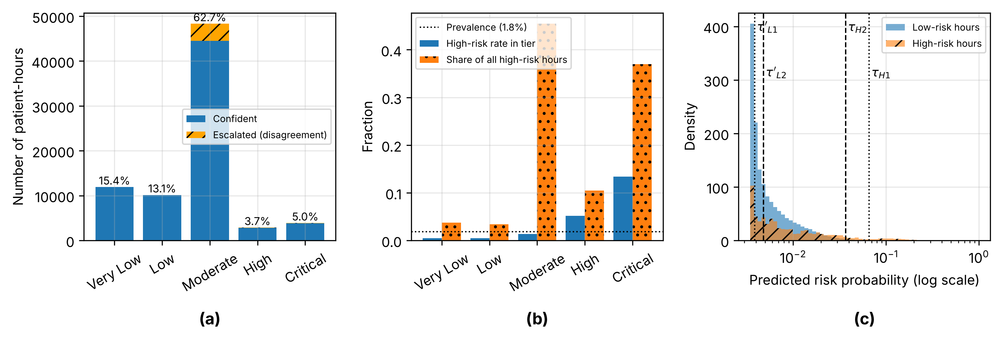

# PHRNet

**Patient-level conformal risk control for guaranteed early-warning risk stratification from IoT vital signs**

PHRNet turns hourly vital signs into five clinical risk tiers (Very Low → Critical) whose **miss rate and false-alarm rate are bounded in advance**. It combines:

- a tabular **Transformer** over feature tokens with **periodic numerical embeddings**,
- a parameter-efficient **TabM-style BatchEnsemble head** (16 members, one forward pass),
- **temperature scaling**, and
- **conformal risk control (CRC) applied per patient**, so that the guarantees remain valid although the hours of one ICU stay are correlated.

Hours on which the ensemble members disagree are escalated to clinician review; this escalation provably never weakens the guarantees.

<p align="center"></p>

## Main results

Data: PhysioNet/Computing in Cardiology Challenge 2019 (sepsis), 20,000 ICU patients, 768,897 patient-hours, 1.82% positive hours.
Mean over 10 patient-level splits. *Miss* = patient-level share of high-risk hours placed in Very Low/Low (target ≤ 5%); *FA* = patient-level share of low-risk hours placed in High/Critical (target ≤ 5%); *Capture* = share of high-risk hours placed in High/Critical. The same decision layer is applied to every model.

| Model | AUC | AUPRC | ECE | Miss (%) | FA (%) | Capture (%) |
|---|---|---|---|---|---|---|
| Logistic Regression | 0.713 ± 0.027 | 0.073 | 0.0023 | 4.43 | 4.88 | 40.2 |
| Random Forest | 0.768 ± 0.014 | 0.087 | 0.0050 | 1.97 | 4.97 | 41.1 |
| XGBoost | 0.795 ± 0.021 | 0.098 | 0.0027 | 3.84 | 4.88 | 46.2 |
| LightGBM | 0.789 ± 0.021 | 0.089 | 0.0028 | 4.05 | 4.85 | 45.2 |
| CatBoost | 0.790 ± 0.023 | 0.096 | 0.0024 | 3.79 | 4.90 | 46.6 |
| MLP | 0.770 ± 0.019 | 0.088 | 0.0026 | 4.44 | 4.90 | 42.8 |
| Attention-MLP + MC dropout | 0.759 ± 0.021 | 0.085 | 0.0024 | 3.59 | 4.90 | 41.9 |
| Deep Ensemble (5 MLPs) | 0.775 ± 0.018 | 0.092 | 0.0020 | 3.77 | 4.87 | 43.9 |
| FT-Transformer | 0.777 ± 0.022 | 0.098 | 0.0027 | 4.45 | 4.81 | 44.8 |
| **PHRNet (proposed)** | **0.783 ± 0.020** | **0.094** | **0.0023** | **3.98** | **4.95** | **44.4** |

- PHRNet has the highest AUC among the neural models and is significantly better than the MC-dropout design (Holm-corrected Wilcoxon *p* = 0.031). Gradient-boosted trees are slightly higher, but not significantly (*p* ≥ 0.19).
- With fixed cut-offs 0.2/0.4/0.6/0.8, the same probabilities put **100%** of high-risk hours into the low tiers; CRC keeps the miss risk at 3.98%.

All numbers are in [`results/`](results/) (`summary_mean.csv`, `summary_std.csv`, `stat_tests.csv`, `results_per_seed.json`).

## Repository layout

```
PHRNet/
├── notebooks/PHRNet_kaggle.ipynb   # full experiment (Kaggle notebook)
├── src/phrnet_experiment.py        # the same code as one Python script
├── scripts/make_figures_4_6.py     # re-draws figures 4 and 6 from saved predictions
├── results/                        # all numbers from the paper (CSV/JSON) + LaTeX tables
├── figures/                        # all figures of the paper
│   └── architecture/               # TikZ source of the architecture diagram (figure 1)
├── requirements.txt
├── CITATION.cff
└── LICENSE
```

## Reproducing the experiments (Kaggle)

1. Create a new Kaggle notebook and upload `notebooks/PHRNet_kaggle.ipynb` (File → Import Notebook).
2. **Add Input** → search **"Prediction of Sepsis"** (PhysioNet/CinC 2019 data, file `Dataset.csv` with columns `SepsisLabel` and `Patient_ID`).
3. Session options → Accelerator → **GPU T4** (or P100).
4. Quick check: set `QUICK_RUN = True` in the first cell and click **Run All** (about 15 minutes).
5. Full run: set `QUICK_RUN = False` and use **Save Version → Save & Run All (Commit)** (about 2.5 hours on a T4).
6. Download `paper_outputs.zip` from the **Output** tab. It contains every table (`tab_*.tex`), figure (`fig_*.png`), the numbers used in the text (`results_macros.tex`) and all per-sample predictions (`predictions.npz`).

Main settings (first cell): `MAX_PATIENTS = 20000`, 10 patient-level splits (70/10/10/10 % train/validation/calibration/test), `ALPHA_MAIN = 0.05`, `ALPHA_STRICT = 0.02`, `K_ENS = 16`.

### Saving results to Google Drive (optional)

Kaggle cannot mount Google Drive, so the notebook can upload results through the Drive API. When enabled, `results_per_seed.json` is uploaded after every split (progress is kept even if the session stops) and `paper_outputs.zip` at the end.

1. In the Google Cloud console, create an **OAuth client ID** (type *Desktop app*) and enable the **Google Drive API**.
2. Generate a **refresh token** for the scope `https://www.googleapis.com/auth/drive.file` (for example with the OAuth 2.0 Playground, using your own client ID and secret).
3. In the Kaggle notebook: **Add-ons → Secrets** → add `GDRIVE_CLIENT_ID`, `GDRIVE_CLIENT_SECRET`, `GDRIVE_REFRESH_TOKEN` and `GDRIVE_FOLDER_ID` (the ID at the end of your Drive folder's URL), and attach them to the notebook.
4. Set `SAVE_TO_GDRIVE = True` in the first cell.

If anything is missing, the upload is skipped with a message and the experiment continues.

### Re-drawing figures 4 and 6 without re-training

```bash
pip install -r requirements.txt
python scripts/make_figures_4_6.py --predictions paper_outputs/predictions.npz \
    --robustness results/robustness.csv --out figures
```

### Compiling the architecture diagram

`figures/architecture/architecture_standalone.tex` compiles with `pdflatex` (packages: `tikz`, `amsmath`, `amssymb`, `geometry`).

## Data

The PhysioNet/Computing in Cardiology Challenge 2019 data are publicly available from [PhysioNet](https://physionet.org/content/challenge-2019/). They are **not** included in this repository. Please cite the challenge paper when using the data:

> M. A. Reyna *et al.*, "Early prediction of sepsis from clinical data: The PhysioNet/Computing in Cardiology Challenge 2019," *Critical Care Medicine*, vol. 48, no. 2, pp. 210–217, 2020.

## Citation

If you use this code, please cite the paper (details will be updated after publication); see [`CITATION.cff`](CITATION.cff).

## License

Code: MIT License (see [`LICENSE`](LICENSE)).
